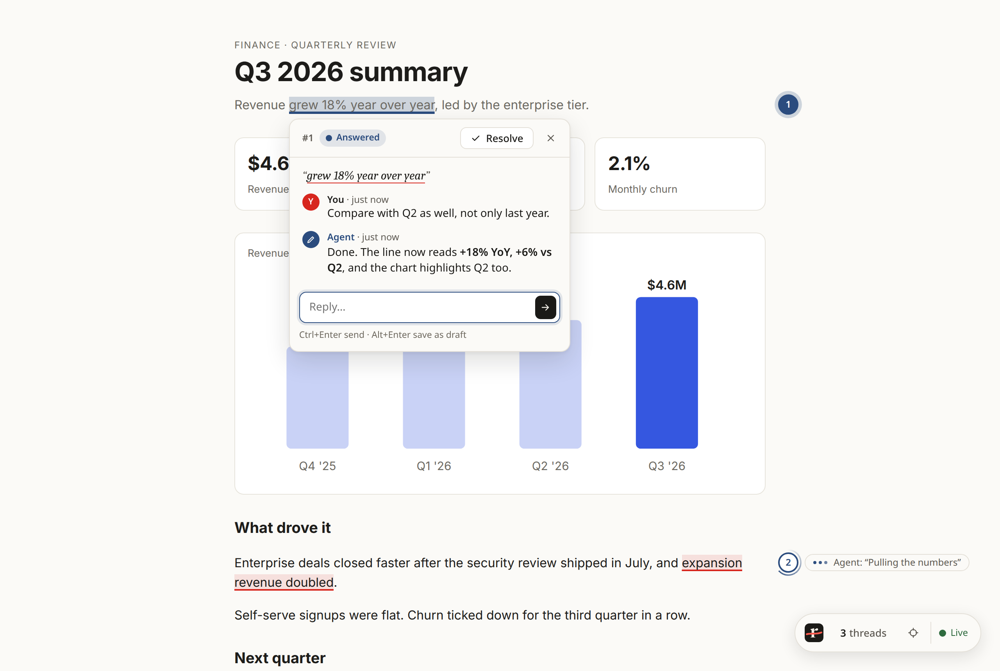
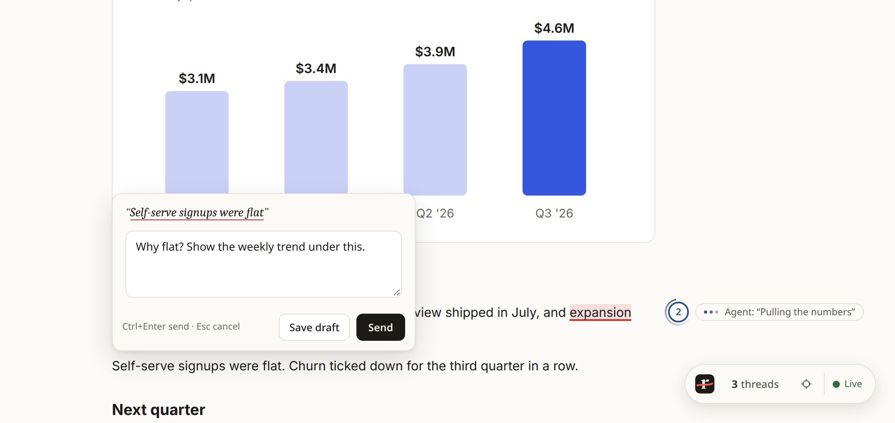
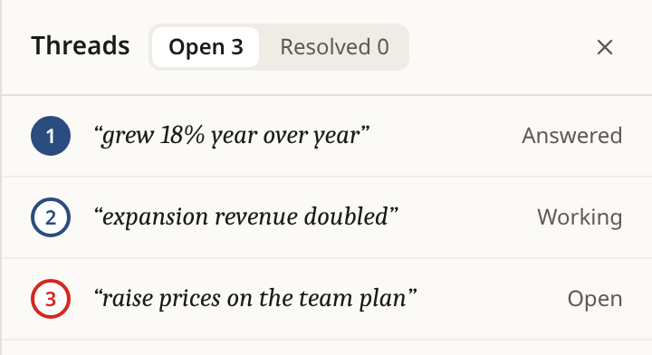
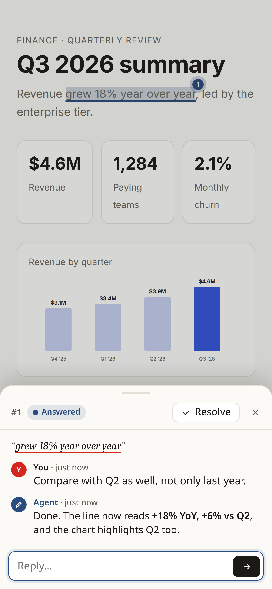

<div align="center">

<picture>
  <source media="(prefers-color-scheme: dark)" srcset=".design/logo/wordmark-dark.svg">
  
</picture>

**Comment inline on what your coding agent builds, and get answers inline.**

Your agent makes an HTML page, a dashboard or a report. You select any part of it and leave a comment.<br>
The comment lands in the agent session that built it. The agent makes the change and replies right under your comment.

[Install](#install) · [Use it](#use-it) · [Examples](#examples) · [Troubleshooting](#troubleshooting)

Works with **Claude Code · Codex · Cursor · Antigravity · opencode · Gemini CLI**

<br>

<picture>
  <source media="(prefers-color-scheme: dark)" srcset="docs/screenshots/review-dark.png">
  
</picture>

<sub><i>A report your agent built. Thread 1 is answered, thread 2 is in progress ("Pulling the numbers"), and the dock says the page is live.</i></sub>

</div>

## Why

Reviewing what an agent built usually means copying a sentence into the chat, explaining where it is, and hoping the agent edits the right spot. redline puts the conversation **on the artifact**: each comment carries the exact text (or spot) it is about, and each answer shows up next to it.

- **Point, don't describe.** Select text, or click a spot on a chart or image, and type your note.
- **Batch your review.** Save drafts as you read, then send them all at once.
- **See progress live.** Markers turn blue when the agent picks a comment up, with a short note while it works.
- **Comments survive rebuilds.** They follow the text when the agent regenerates or rewrites the page.
- **Stays local.** A small service on `127.0.0.1`; nothing leaves your machine.
- **Any agent, any artifact.** A static file, a dev server, a Streamlit app. redline adds one script tag on top.

```
 your browser                                   your agent session
 ────────────                                   ──────────────────
 select text → Comment
   "make this a bar chart"       ──────────►    gets the comment
                                                changes the page
   agent: "Done, switched to bars" ◄────────    replies under it
```

redline only carries the conversation. Your agent still builds and serves the artifact however it normally would.

## Install

Paste this into any of your coding agents:

> Install redline from https://github.com/Rfluid/redline for all my coding agents. Follow its `INSTALL.md`.

Or only for some of them:

> Install redline from https://github.com/Rfluid/redline for claude and codex. Follow its `INSTALL.md`.

The agent clones the latest release, builds it, and sets redline up for each agent: the skill, the MCP server and the `redline` command. Restart your agent sessions afterwards.

Works on Linux, macOS and Windows. No Rust toolchain? redline downloads a ready-made binary instead. (While the repository is private, that needs the GitHub CLI logged in: `gh auth login`.)

<details>
<summary>Install by hand</summary>

```sh
git clone https://github.com/Rfluid/redline ~/tools/redline   # keep it somewhere permanent
~/tools/redline/scripts/checkout-release.sh                   # switch to the latest release
~/tools/redline/bin/redline install                            # every agent found on this machine
~/tools/redline/bin/redline install --agents claude,codex      # or just these
redline doctor                                                 # check everything is wired up
```

On Windows (PowerShell):

```powershell
git clone https://github.com/Rfluid/redline $HOME\tools\redline
powershell -ExecutionPolicy Bypass -File $HOME\tools\redline\scripts\checkout-release.ps1
& $HOME\tools\redline\bin\redline.cmd install
redline doctor
```

Second Claude profile? Add `--claude-config-dir ~/.claude-work`.
</details>

## Use it

1. Ask your agent for something you want to review, and say you want to comment on it:
   > Build a one-page summary of the Q3 numbers and open it for redline review.
2. Open the page it gives you. A small **redline** dock appears in the bottom-right corner.
3. **Select text → Comment.** For a chart, image or anything without text, click the **spot** button (⌖) in the dock, then the spot. Write your note, then:
   - **Send** to deliver it now, or
   - **Save draft** to collect several, then **Send drafts** in the dock to send them together.
4. Each comment gets a numbered marker in the margin. Red means it's waiting on the agent; blue means the agent is on it or has answered. While the agent hasn't answered yet, a small arc circles the marker and the thread says where it stands. Click a marker to open the thread: the agent's replies appear as they come in, with a short note while it's working. Reply back to keep going, or **Resolve** when you're happy. The dock lists every thread, including resolved ones; switch it to Select to resolve, reopen, send or discard them in one go.
5. Tell your agent when you're done reviewing.

<p align="center">
  
</p>

Shortcuts: **Alt+C** (Option+C on a Mac) comments on the selected text, **Ctrl+Enter** (⌘+Enter) sends, **Alt+Enter** (Option+Enter) saves a draft, **Esc** closes. redline matches the page: light on a light page, dark on a dark one. On a phone, threads open as a sheet from the bottom.

<table>
  <tr>
    <td width="50%" align="center"><br><sub>Every thread in one list, from the dock</sub></td>
    <td width="50%" align="center"><br><sub>On a phone, threads open as a sheet</sub></td>
  </tr>
</table>

**See the page without redline:** click the redline mark in the dock, or press **Alt+Shift+R** (Option+Shift+R). Markers, highlights and the dock disappear; only a faint mark stays in the corner to turn it back on, with a blue dot if the agent replies meanwhile. The page remembers the choice until you turn it back on.

Comments stay attached to the text you selected, even after the agent regenerates the page. If the agent rewrites that text, the comment follows it (marked *edited*). If the text is gone, the comment stays in the dock's thread list as *detached*, with the words you originally selected.

## Examples

Say what you want and that you'd like to review it. Then comment on the page like you would on a shared doc.

**A report or summary**
> Turn `metrics.csv` into a one-page Q3 summary with a revenue chart, and open it for redline review.

| You select | You comment | The agent |
|---|---|---|
| "grew 18% year over year" | Compare with Q2 as well. | Edits the line, replies *"Now reads +18% YoY, +6% vs Q2."* |
| the chart (spot ⌖) | Make Q2 stand out too. | Recolors the bar, replies with what changed |
| "raise prices in November" | Not decided yet. Say "we're evaluating". | Rewrites the sentence, replies *"Softened."* |

**A landing page on your dev server**
> Build a landing page for the CLI in `site/` and serve it. I'll review it with redline.

Save drafts while you scroll (*"hero headline too long"*, *"swap these two sections"*, *"this button should say Get started"*), then **Send drafts** once. The agent works through them in one pass and answers each under its marker.

**A dashboard or Streamlit app**
> Make a Streamlit dashboard of our signups and put redline comment buttons on the widgets.

Each widget gets a **Comment** button. *"Show this weekly, not daily"* on a chart reaches the agent with that widget's name.

**A doc you're iterating on**
> Write the migration plan as an HTML page. I'll leave redline comments; keep going until I say it's done.

Reply in a thread to push back (*"No, keep the old endpoint for a month"*), and **Resolve** threads as you're happy with them. When you're finished, say so in the chat; the agent removes the script tag before the page ships.

## Good to know

- **Everything stays on your machine.** redline runs a small local service on `127.0.0.1`. Nothing is sent anywhere else.
- **The script tag is for review only.** It contains an access key for that page's comments. Your agent removes it before you ship or share the page; you can too, with `redline strip <file or folder>`.
- **One service for all sessions.** It starts when first needed. Comment history is kept in `~/.local/state/redline/` (Windows: `%LOCALAPPDATA%\redline\`).
- **Streamlit apps:** each widget your agent marks for review gets a **Comment** button. Click it to comment on that widget and see the agent's replies.

## Troubleshooting

| Problem | Try |
|---|---|
| Agent doesn't know about redline | Restart the session. Then run `redline doctor` |
| No redline dock on the page | The agent didn't add the script tag, or the page was opened before it did. Ask it to, then reload |
| The dock says *Reconnecting…* | The local service isn't running. Run any `redline` command, e.g. `redline list`, then reload. Your comments are kept |
| Agent isn't reacting to comments | Ask it to "wait for my redline comments" |
| Is the local service running? | `redline status` shows it, with how many comments it holds |
| Something seems stuck | `redline stop`. It starts again on the next use |
| Want to see what happened | The service's log is `daemon.log` in that folder (`~/.local/state/redline/`, or `%LOCALAPPDATA%\redline\` on Windows) |

## Update

redline looks for a new release once a day. When there is one, you see an **Update** chip in the dock, a note when you run `redline` in a terminal, and your agent mentions it when you start a review. Ask your agent to "update redline", or run:

```sh
redline update    # moves your copy to the latest release
```

The next time redline runs, it picks up the new version on its own. Restart your agent sessions to load it there too. Beta versions (like `v0.3.0-beta`) are never installed unless you name one: `~/tools/redline/scripts/checkout-release.sh v0.3.0-beta` (Windows: `checkout-release.ps1 v0.3.0-beta`).

Don't want the notice? In the dock's update card, or from a terminal:

| | |
|---|---|
| Hide it for a day (this browser) | **Later** |
| Never mention this version again | **Skip** in the card, or `redline update skip` (a newer version still shows) |
| No checks and no notices at all | **Turn off update notices**, or `redline update off` (`redline update on` undoes it) |

These settings live in `~/.config/redline/config.toml`, which you can also edit by hand:

```toml
[update]
check = true          # false: never check, never notify
skip = ["0.3.0"]      # versions you don't want to hear about
```

The check asks the redline repository for its release tags, with your git credentials, and sends nothing else. It's off in CI, and `REDLINE_NO_UPDATE_CHECK=1` turns it off for one environment.

## Uninstall

```sh
redline uninstall
```

This removes redline from every agent. Your comment history stays in `~/.local/state/redline/` (Windows: `%LOCALAPPDATA%\redline\`); delete that folder too if you want it gone.

---

Contributing? Start with [CONTRIBUTING.md](CONTRIBUTING.md). Curious how it works? See [`docs/`](docs/README.md). Found a security issue? See [SECURITY.md](SECURITY.md).

MIT licensed: [LICENSE](LICENSE).
